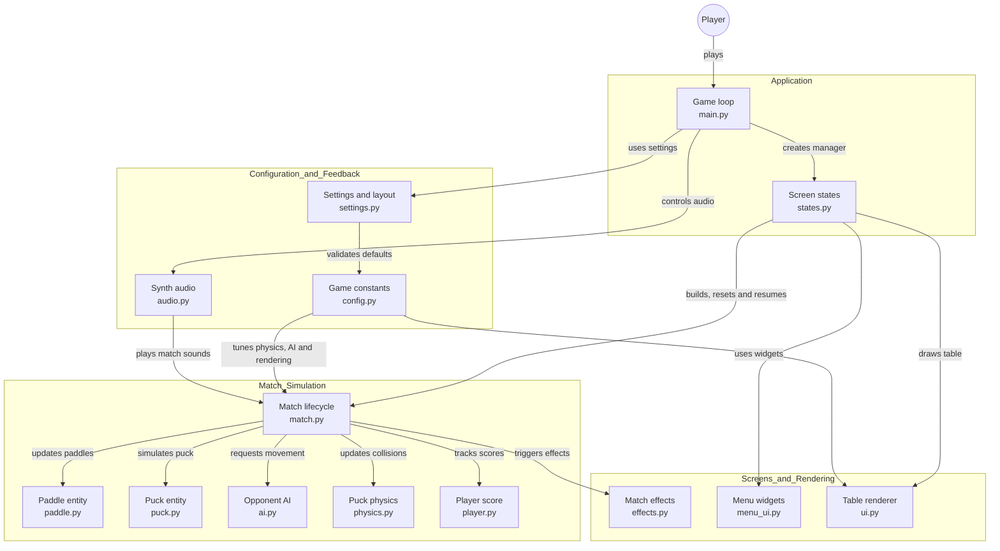

# TABLE HOCKEY

**A modern arcade-style air hockey game built with Python and Pygame-CE.**

Table Hockey is a single-player arcade air hockey game. Control the blue paddle, compete against a CPU opponent, score goals, and work your way through four difficulty levels. The project uses a modular Python architecture that separates the application loop, screen states, match simulation, entities, physics, rendering, audio, and settings.

## Architecture diagram

The following Mermaid diagram recreates the architecture and relationships shown in the supplied project diagram.



## Features

- **Arcade air hockey gameplay** with a player paddle, CPU paddle, puck, goals, and score tracking.
- **Four CPU difficulty presets:** Easy, Normal, Hard, and Nightmare.
- **Match flow:** pre-serve countdown, active play, goal celebration, pause, victory, and game-over screens.
- **Adjustable match rules:** choose the winning score and tune puck and paddle speeds.
- **Visual effects:** puck trails, glow, impact particles, goal effects, celebration effects, and optional screen shake.
- **Multiple table palettes:** Neon, Cyber, and Sunset.
- **Graphics quality presets:** Low, Medium, and High.
- **Audio controls:** separate master, music, and sound-effect volume controls, plus a music enable toggle.
- **Display options:** windowed/fullscreen mode, supported resolutions, FPS cap, and FPS counter.
- **Control customization:** remap the movement keys.
- **Career records:** win/loss totals, current streak, best winning time, and recent match history are stored locally.
- **Keyboard and mouse menu navigation.**

## Gameplay

The player controls the blue paddle on the left side of the table. The CPU controls the red paddle on the right. Hit the puck into the opponent's goal while defending your own goal.

A match begins with a countdown. A goal triggers a short celebration before play resumes. The first side to reach the configured winning score ends the match and displays the appropriate result screen.

The default winning score is **5 goals**. It can be adjusted in Settings.

## Controls

| Action | Default input |
|---|---|
| Move paddle up | `W` |
| Move paddle left | `A` |
| Move paddle down | `S` |
| Move paddle right | `D` |
| Pause / resume flow | `Esc` |
| Navigate menus | `W` / `S` or `↑` / `↓` |
| Select menu item | `Enter` or `Space` |
| Change difficulty from the main menu | `←` / `→` |

Movement bindings can be changed in **Settings**. Menu buttons can also be selected with the mouse.

## Difficulty levels

The CPU presets tune its reaction interval, movement speed, aim variation, and forward pressure.

| Difficulty | Intended challenge |
|---|---|
| Easy | Slower reactions and more aim variation |
| Normal | Balanced default opponent |
| Hard | Faster reactions and more accurate play |
| Nightmare | Very fast reactions, high accuracy, and aggressive positioning |

The exact tuning values are maintained in `TABLE_HOCKEY/config.py`.

## Settings and customization

The Settings screen provides controls for:

- Master, music, and sound-effect volume.
- Music enable/disable.
- CPU difficulty.
- Puck speed and paddle speed.
- Winning score.
- Fullscreen and resolution.
- FPS cap and FPS counter.
- Screen shake.
- Graphics quality.
- Table theme.
- Player movement keybindings.

Available table themes:

- **Neon** — the default blue/red arcade palette.
- **Cyber** — a cooler cyan/blue palette.
- **Sunset** — a warmer magenta/red palette.

Graphics quality presets control optional rendering effects. Low disables trails and glow and reduces particles; Medium enables trails and a limited particle count; High enables trails, glow, and the highest configured particle allowance.

## Architecture and module responsibilities

### Application and screen flow

- `main.py` is the entry point. It initializes Pygame, loads settings, starts audio, creates the match, and runs the game loop.
- `states.py` contains the state manager and the menu, settings, help, playing, pause, leaderboard, victory, and game-over screens.
- The state manager forwards update, draw, and input handling to the active screen state.

### Match simulation

- `match.py` coordinates the match lifecycle: countdown, serving, active play, goals, pause, and win conditions.
- `paddle.py` defines paddle movement and rendering behavior.
- `puck.py` defines puck state and movement.
- `player.py` contains player data and controller behavior.
- `ai.py` controls the CPU opponent.
- `physics.py` handles puck movement, collisions, and goal detection.
- `effects.py` manages impact, goal, particle, screen-shake, and celebration effects.

### Screens and rendering

- `menu_ui.py` provides reusable menu widgets such as buttons, sliders, toggles, selectors, and text drawing.
- `ui.py` renders the air hockey table and its visual presentation.
- The application draws the paddles, puck, effects, and match HUD over the table renderer.

### Configuration and feedback

- `config.py` centralizes display constants, table geometry, colors, physics tuning, difficulty presets, defaults, and graphics quality flags.
- `settings.py` loads, validates, and saves preferences, and calculates layout geometry for the active resolution.
- `audio.py` manages background music, sound effects, and volume levels.
- Match results are written to the local career/high-score data file by the screen/state layer.

## Project structure

```text
Table-Hockey/
├── TABLE_HOCKEY/
│   ├── main.py          # Application entry point and game loop
│   ├── states.py        # Screen state manager and game screens
│   ├── match.py         # Match lifecycle and scoring
│   ├── ai.py            # CPU opponent controller
│   ├── physics.py       # Puck movement and collision simulation
│   ├── paddle.py        # Paddle entity
│   ├── puck.py          # Puck entity
│   ├── player.py        # Player data and controllers
│   ├── effects.py       # Particles, impacts, goals, and celebrations
│   ├── ui.py            # Table renderer
│   ├── menu_ui.py       # Reusable menu widgets
│   ├── audio.py         # Music and sound effects
│   ├── settings.py      # Settings persistence and layout geometry
│   ├── config.py        # Shared constants and tuning
│   ├── requirements.txt # Python dependencies
│   └── save/            # Runtime settings and career records
└── README.md
```

Runtime save files are generated as the game is used; they may not exist in a fresh clone.

## Requirements

- Python **3.12** is the project's configured Python version.
- Pygame-CE (installed from `TABLE_HOCKEY/requirements.txt`).
- Windows, macOS, or Linux with a working display/audio environment supported by Pygame.

## Installation and launch

### Windows PowerShell

Clone the repository and enter the project directory:

```powershell
git clone https://github.com/sharpp08/Table-Hockey.git
cd Table-Hockey
```

Create and activate a virtual environment:

```powershell
py -3.12 -m venv .venv
.\.venv\Scripts\Activate.ps1
```

Install the dependencies and start the game:

```powershell
python -m pip install --upgrade pip
python -m pip install -r .\TABLE_HOCKEY\requirements.txt
python .\TABLE_HOCKEY\main.py
```

### macOS / Linux

```bash
git clone https://github.com/sharpp08/Table-Hockey.git
cd Table-Hockey
python3.12 -m venv .venv
source .venv/bin/activate
python -m pip install --upgrade pip
python -m pip install -r TABLE_HOCKEY/requirements.txt
python TABLE_HOCKEY/main.py
```

## Save data

The game stores runtime data inside `TABLE_HOCKEY/save/`:

- `settings.json` — user preferences such as volume, resolution, difficulty, graphics quality, theme, and keybindings.
- `high_scores.json` — career results, wins/losses, streaks, best times, and recent matches.

These files are created as needed. Keep a backup if you want to preserve settings and career history before reinstalling or resetting local game data.

## Development notes

- The project is built with **Python and Pygame-CE**; the game is not a Godot project.
- Keep gameplay simulation, rendering, screen-state handling, and settings responsibilities separated when extending the code.
- Add new shared tuning values to `config.py` rather than scattering constants across modules.
- Preserve existing save data when changing settings or career-record formats.
- Test a full match lifecycle after changes: launch, score goals, pause/resume, win, lose, rematch, and return to the main menu.
- Test each difficulty and graphics quality preset, and check that settings persist after restarting.

## Repository

[sharpp08/Table-Hockey](https://github.com/sharpp08/Table-Hockey)
